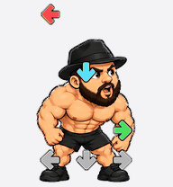
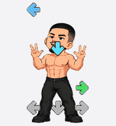

# Codex Pets：闹吃大战古振兴

把原视频里的两位唱歌人物做成可预览的 Codex Pets：左边是 **闹吃**，右边是 **古振兴**。仓库收录当前精灵图、动画 GIF，以及直接读取精灵图的双人互动预览。

| 闹吃 | 古振兴 |
| :---: | :---: |
|  |  |
| [下载精灵图](assets/pets/naochi/spritesheet.png) · [全部动作](assets/pets/naochi/all-states.gif) | [下载精灵图](assets/pets/guzhenxing/spritesheet.png) · [全部动作](assets/pets/guzhenxing/all-states.gif) |

通过仓库的 **Code → Download ZIP** 下载并解压后，在本地打开 [index.html](index.html) 即可查看双人预览，无需安装依赖或构建。默认播放唱歌动作；勾选同步时，两人一起切换动作和方向，取消同步后可以分别控制。方向模式播放时按顺时针遍历 16 个方向，暂停后可固定查看某一方向。画面直接裁取原始 Atlas 中的 192 × 208 单元格。

## 当前人物与动作

- 闹吃：黑帽、浓胡子，保留原视频的待机与唱歌动作；素材版本为修订 2。
- 古振兴：贴头、低发量的短发，小胡子；素材版本为修订 4。唱歌时两手的大拇指、食指、中指展开，无名指和小指收起。
- 待机和方向查看时没有彩色音符下落，保留固定灰色接收箭头。
- 动作时保留左、下、右三条音符。音符的形状、尺寸和横向位置固定，只沿纵向下落并循环回到上方；角色跳跃不会带动音符层。

## 精灵图格式

两张图均为透明 RGBA PNG，采用 v2 布局：**1536 × 2288**，8 列 × 11 行；每格 **192 × 208**，共 73 个使用帧。没有使用的格子为空白。

| 行（从 0 开始） | 状态 | 使用帧数 |
| --- | --- | ---: |
| 0 | `idle` 待机 | 6 |
| 1 | `running-right` 向右移动 | 8 |
| 2 | `running-left` 向左移动 | 8 |
| 3 | `waving` 挥手 | 4 |
| 4 | `jumping` 跳跃 | 5 |
| 5 | `failed` 失败 | 8 |
| 6 | `waiting` 等待 | 6 |
| 7 | `running` 唱歌 / 工作 | 6 |
| 8 | `review` 检查 | 6 |
| 9 | 方向 0°–157.5° | 8 |
| 10 | 方向 180°–337.5° | 8 |

16 个方向以 22.5° 为间隔，从上方 0° 开始顺时针排列：90° 向右、180° 向下、270° 向左。动作帧的播放时长沿用交付 GIF 的节奏。

[assets/manifest.json](assets/manifest.json) 记录每个素材的相对路径、版本、尺寸、帧数、字节数与 SHA-256，方便核对或接入其他播放器。

## 文件

```text
assets/
  manifest.json
  pets/
    naochi/
    guzhenxing/
      spritesheet.png
      singing-main.gif
      all-states.gif
      idle-jump-idle.gif
      look-loop.gif
index.html
script/preview.js
style.css
```

人物、动作与音游箭头参考：[闹吃 vs 古振兴原视频](https://www.bilibili.com/video/BV1esbf6wEkc/)。仓库仅收录本次制作的宠物素材与预览代码；原视频未收录，人物参考来自该视频。
